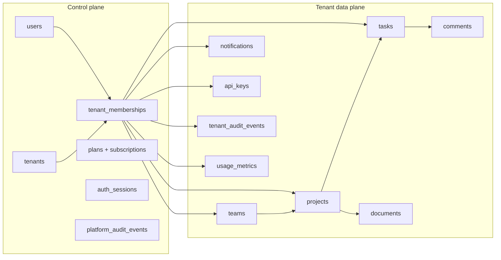
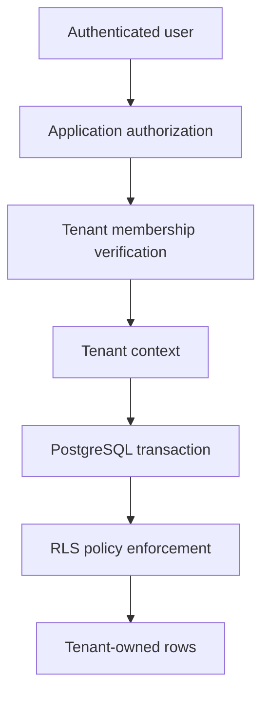

# TenantCore architecture

## 1. Purpose and boundaries

TenantCore separates the **control plane** (identity, plans, organizations, sessions, platform audit) from the **tenant data plane** (teams, projects, tasks, records, notifications, usage, tenant audit). The separation guides authorization and operations; it does not imply that application filters are sufficient for isolation.



Every tenant-owned row has an explicit `tenant_id`. Relationships that could cross a boundary use composite foreign keys:

```text
tasks(tenant_id, project_id)
  → projects(tenant_id, id)

projects(tenant_id, team_id)
  → teams(tenant_id, id)

comments(tenant_id, task_id)
  → tasks(tenant_id, id)
```

Thus a task with Acme's `tenant_id` cannot reference Globex's project ID even if an application query constructs the relationship incorrectly.

## 2. Request and transaction flow



The concrete dependency path is:

1. `get_current_principal` validates a signed, expiring JWT and its persisted session, or validates an API-key hash/expiry/revocation state.
2. `get_tenant_context` parses an optional `X-Tenant-ID` as a UUID. A client may request a tenant but cannot assert membership.
3. The backend reads the membership using the authenticated user ID. Non-admin users require `status = active`; API keys also require a valid key-owning membership.
4. The tenant must be `active`. `provisioning`, `suspended`, and `archived` organizations are rejected.
5. The same SQLAlchemy transaction receives `set_config(..., true)` values for tenant, user, platform-admin flag, and request ID. `true` makes them transaction-local.
6. Controllers execute ORM queries with parameterized values. Application role dependencies guard administrative actions and API-key scopes guard writes.
7. PostgreSQL applies RLS `USING` to visible rows and `WITH CHECK` to new/changed rows. Composite FKs apply a second relational constraint.
8. The domain mutation and audit event commit together. An exception rolls back both and becomes a consistent error response.

`SET LOCAL`/transaction-local context is compatible with transaction pooling only because all context and work stay inside one transaction. Connections are never configured with a tenant outside that boundary.

## 3. Domain boundaries

### Platform

- `plans`: global plan catalog and limits, not billing enforcement.
- `tenants`: identity, slug, lifecycle, plan, JSONB configuration, lifecycle timestamps.
- `users`: global identity. A user can have several memberships.
- `tenant_memberships`: composite `(tenant_id, user_id)` identity, tenant-specific role/status, invitation metadata.
- `auth_sessions`: refresh-token hash, expiry, revocation, rotation linkage.
- `platform_audit_events`: login, lifecycle, platform administration, distinguishable from tenant events.

### Tenant

- `teams`, `projects`, `tasks`, `documents`, `comments`: representative SaaS delivery domain.
- `notifications`: tenant and recipient-bound, with an additional RLS recipient guard.
- `api_keys`: hash/prefix/scope/expiry/revocation; plaintext secrets are not stored.
- `subscriptions`: current plan period and external reference slot; billing is not coupled to RLS.
- `usage_metrics`: `(tenant_id, UTC date, metric)` unique daily values.
- `tenant_audit_events`: append-only tenant security/activity trail.

## 4. Identifiers, time, and constraints

UUIDv4 was selected for distributed-safe generation in API, seed, and worker processes without a central sequence. UUIDs also avoid meaningful sequential resource IDs, although authorization still depends on RLS rather than ID opacity. The database uses `gen_random_uuid()` defaults and the application can generate UUIDs before insert. UUIDv7 may improve B-tree locality later but requires a deliberate migration and is not necessary for isolation.

All event timestamps use `timestamptz` and UTC. Daily usage uses a UTC `date`. Constraints cover lifecycle/status/role values, nonnegative usage/storage, valid subscription periods, nonempty comments, lowercase emails, safe slugs, unique tenant slugs, unique tenant-scoped team names, and idempotent usage keys.

## 5. Index strategy

Indexes are based on actual access paths:

| Query pattern | Index |
|---|---|
| Newest tenant projects/audit | `(tenant_id, created_at DESC)` |
| Filter projects by state | `(tenant_id, status)` plus an active partial index |
| Tasks within a project | `(tenant_id, project_id, status)` |
| Assignee workload | `(tenant_id, assignee_id, status)` |
| Open work due soon | Partial `(tenant_id, due_date)` where open and due |
| Unread notifications | Partial `(tenant_id, user_id, created_at)` |
| Daily tenant usage | Unique `(tenant_id, period_date, metric)` |

Indexes do not replace policy predicates. PostgreSQL can use the leading `tenant_id` for both the RLS predicate and request filters. Evaluate `EXPLAIN (ANALYZE, BUFFERS)` under realistic data and RLS before adding more.

## 6. Provisioning and lifecycle

```mermaid
stateDiagram-v2
  [*] --> Provisioning: platform admin creates tenant + subscription atomically
  Provisioning --> Active: explicit activation
  Active --> Suspended: suspend
  Suspended --> Active: reactivate
  Provisioning --> Archived: archive
  Active --> Archived: archive
  Suspended --> Archived: archive
  Archived --> [*]: retained; terminal in this implementation
```



Provisioning does not fabricate a tenant administrator. A platform admin can perform initial membership setup through the same tenant-scoped endpoint, then hand control to the tenant admin. Lifecycle and membership changes generate audit events.

The RLS guard independently requires `app.tenant_is_active()` for tenant-owned rows. Therefore a missed application lifecycle check still does not expose protected data.

## 7. Background architecture

Celery uses Redis as broker/result backend. Jobs receive primitive UUID strings, open a fresh transaction, set explicit context, and perform one tenant's work. There is no process-global “current tenant.” The dispatcher reads active tenant IDs in a control-plane transaction and fans out child jobs carrying those IDs.

- `aggregate_usage(tenant_id)`: absolute daily gauges are idempotent; transient operational errors use bounded exponential retry.
- `project_report(tenant_id, project_id)`: read model used to prove a job created for Acme cannot read Globex's project.
- `dispatch_usage_aggregation()`: scheduler entry; only the dispatcher is tenant-unscoped.

Late acknowledgment and prefetch=1 favor safe work distribution. Production should run worker and beat as separate processes, monitor retries/dead letters, and add idempotency keys to any future non-idempotent delivery job.

## 8. Observability and health

Every request receives a UUID request ID returned in `X-Request-ID` and included in JSON logs. Logs include method, route template (not raw high-cardinality IDs), status, duration, tenant/user IDs when established, and error type—not passwords, tokens, or SQL error details. Prometheus exposes request count/latency with route templates.

- `/health/live`: process is responsive; does not claim dependencies are healthy.
- `/health/ready`: checks PostgreSQL; local development also reports Redis status.
- `/metrics`: Prometheus text format; should be network-restricted in production.

Grafana/OpenTelemetry are intentionally not required at this scale. Add tracing when there is a measured distributed debugging need and a collector/backend to receive it.

## 9. Scaling posture

Start with bounded connection pools, pagination, tenant-leading indexes, efficient counts/aggregates, short transactions, and autovacuum monitoring. Avoid long-running report transactions on the primary. Consider read replicas only for workloads that tolerate replication lag and never as a shortcut around RLS context.

Large single-tenant growth can create skew even when total tenant count is small. Use table/index sizes, lock waits, vacuum lag, query plans, and p95 latency to decide when partitioning or dedicated infrastructure is justified. See [multi-tenancy.md](multi-tenancy.md) for the hybrid path.
