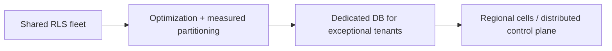

# Multi-tenancy strategies

## What multi-tenancy means

A multi-tenant system serves several independent customers from shared application infrastructure while preserving each customer's confidentiality, integrity, configuration, lifecycle, and operational expectations. “Tenant” usually means an organization, not an individual user. Users can belong to multiple tenants with different roles.

Isolation matters because a single missed predicate can become a reportable data breach. Availability and noisy-neighbor behavior also matter: one customer's workload should not make every other customer unusable. These are related but distinct concerns; RLS addresses row authorization, not resource fairness.

## Comparison

| Concern | Shared schema + RLS | Schema per tenant |
|---|---|---|
| Tenant isolation | Database policies | Schema boundary plus privileges/search_path |
| Operational complexity | Lower | Higher |
| Tenant provisioning | Simple | More complex |
| Cross-tenant analytics | Easier | More complex |
| Large tenant customization | More difficult | Easier |
| Migration complexity | Lower | Higher |
| Number of database objects | Lower | Potentially very high |
| Isolation model | Row-level | Schema-level |
| Scalability | Strong for many tenants | Requires careful management |
| Backup/restore | Usually whole-fleet; selective restore is harder | Schema-level dump is easier, but dependencies/registry remain |
| Noisy-neighbor control | Shared planner/pool/resources | Still shared unless separately resourced |
| Tenant-specific columns | JSONB/controlled shared evolution | Easier structural divergence, harder fleet consistency |
| Catalog/autovacuum pressure | Lower | Higher as tables/indexes multiply |

Neither model is universally superior. RLS is a strong default for many similarly shaped tenants and a unified migration lifecycle. Schema-per-tenant can be appropriate when tenant-level customization and schema-level operations outweigh fleet-wide object/migration overhead. Dedicated databases provide a stronger operational/regulatory boundary at the highest per-tenant cost.

## When shared RLS fits

- Hundreds or thousands of tenants share a mostly stable domain model.
- Cross-tenant platform analytics and administration are routine.
- Centralized backup, migration, and connection management are preferred.
- The team can review/test policies and constrain database roles carefully.
- Tenant-specific configuration can use JSONB or feature flags rather than arbitrary DDL.

## When schema-per-tenant fits

- Customers require substantial table/index/custom-function variation.
- Per-schema logical export is a frequent operational requirement.
- A controlled provisioning/migration fleet exists with strong observability.
- The expected schema count and catalog growth are understood and benchmarked.
- Schema privileges and search_path handling are treated as security boundaries.

Schema separation alone is not enough if a runtime role can read every schema or a client can inject `search_path`. See [schema-per-tenant.md](schema-per-tenant.md).

## Authentication, authorization, and isolation are different

```text
Authentication  → Who is the user?
Authorization   → What may the user do?
Membership      → Which organization may the user select?
Isolation       → Which rows will the database permit?
```

A valid user can be unauthorized for an action. An authorized tenant admin still must not access another tenant. Hiding UI controls does not enforce any of these server/database properties.

## Performance and scalability levers

1. **Measure first:** p95/p99 latency, row counts per tenant, buffer hits, lock time, pool wait, vacuum lag, table/index growth.
2. **Keep transactions short:** context setup, operation, and audit should not wrap external API calls.
3. **Bound pools:** size API/worker pools against PostgreSQL capacity; queue excess work instead of opening unlimited connections.
4. **Paginate and aggregate deliberately:** avoid unbounded tenant lists and expensive fleet counts per request.
5. **Maintain indexes/autovacuum:** tenant-leading composite indexes and partial indexes must be validated with real plans.
6. **Control background fan-out:** per-tenant jobs need bounded concurrency to prevent a large tenant monopolizing workers.
7. **Partition only when justified:** declarative partitioning adds operational complexity and does not replace RLS. A partition key generally needs to align with tenant/time queries and constraints.
8. **Read replicas where appropriate:** replicas can scale eventually consistent reads, not writes or lag-sensitive authorization checks. RLS still applies.

## Evolution to hybrid tenancy



A future registry can map a tenant to an isolation mode and database cluster:

```text
tenant_id | mode        | cluster      | schema/version | lifecycle
----------+-------------+--------------+----------------+----------
small     | shared_rls  | shared-eu-1  | head           | active
large     | dedicated   | dedicated-7  | head           | active
```

The application must resolve this mapping server-side and use separate credentials/pools. It must not accept a client-provided isolation mode or DSN.

### Move a tenant when measurements justify it

- Sustained storage/IOPS or lock/vacuum pressure despite optimization.
- Regulatory/residency or customer-contract requirements.
- Independent maintenance windows, encryption keys, or point-in-time recovery objectives.
- A need for custom PostgreSQL extensions/settings incompatible with the shared fleet.
- Predictable high workload that justifies dedicated cost.

### Migration outline

1. Inventory dependencies, schema/version, foreign keys, audit continuity, and usage state.
2. Fence new writes or use a carefully engineered replication/cutover process.
3. Export and restore using tenant-appropriate tools; do not assume schema-level dump captures global users/plans.
4. Apply migrations and verify row counts, invariants, RLS/privileges, and application smoke tests.
5. Update the server-side registry and atomically cut over routing.
6. Monitor, retain rollback artifacts for a defined window, then decommission old data under approval.

This is an operational migration, not a runtime tenant switch. RLS and schema-per-tenant rows should not be silently interleaved.
