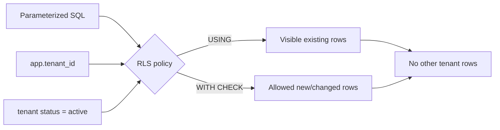

# PostgreSQL Row-Level Security in TenantCore

## 1. Why the database is the final boundary

An application filter such as `WHERE tenant_id = :tenant_id` is useful for query clarity and index selection, but a missing filter, unsafe join, background-job mistake, or future endpoint can bypass it. TenantCore enables and forces RLS so PostgreSQL applies the tenant predicate independently of controller filters.



The policy is not presented as protection from a database superuser or as a substitute for application authorization. It is a defense-in-depth boundary with a specific trust model.

## 2. Runtime roles and privileges

| Role | Purpose | Important restrictions |
|---|---|---|
| Migration/admin role | Alembic DDL, initial role setup, controlled seed control plane | Never exposed to frontend or normal request connections |
| `tenantcore_app` | API and worker data access | `NOSUPERUSER`, `NOBYPASSRLS`, `NOCREATEDB`, `NOCREATEROLE`, `NOINHERIT`; no table ownership |
| End user | Authenticated principal only | Has no PostgreSQL credentials or direct connection |

The migration grants only necessary privileges. For example, audit tables allow SELECT/INSERT but not UPDATE/DELETE; API keys allow SELECT/INSERT/UPDATE for revocation and `last_used_at`, but not DELETE. `FORCE ROW LEVEL SECURITY` prevents a non-superuser table owner from silently avoiding policies. PostgreSQL superusers and explicitly privileged roles remain outside the application trust boundary.

## 3. Transaction-local context

The backend executes the equivalent of:

```sql
SELECT set_config('app.tenant_id', :verified_tenant_uuid, true);
SELECT set_config('app.user_id', :authenticated_user_uuid, true);
SELECT set_config('app.is_platform_admin', :server_derived_boolean, true);
SELECT set_config('app.request_id', :request_uuid, true);
```

The third argument `true` scopes values to the current transaction. Policy helpers read them with `current_setting(..., true)` and turn an empty value into `NULL`. An unknown/empty tenant therefore matches no tenant-owned rows.

```sql
CREATE FUNCTION app.current_tenant_id() RETURNS uuid
LANGUAGE sql STABLE PARALLEL SAFE
AS $$ SELECT NULLIF(current_setting('app.tenant_id', true), '')::uuid $$;
```

The request path verifies membership before setting the tenant and uses the same transaction for verification and work. Tests also verify that context disappears after rollback/commit before a pooled connection is reused.

## 4. Core policies

For teams, projects, tasks, documents, comments, subscriptions, usage, credentials, and audit data, the essential guard is:

```sql
tenant_id = app.current_tenant_id() AND app.tenant_is_active()
```

Each table has four policies:

```sql
CREATE POLICY projects_select ON projects FOR SELECT
  USING (tenant_id = app.current_tenant_id() AND app.tenant_is_active());
CREATE POLICY projects_insert ON projects FOR INSERT
  WITH CHECK (tenant_id = app.current_tenant_id() AND app.tenant_is_active());
CREATE POLICY projects_update ON projects FOR UPDATE
  USING (tenant_id = app.current_tenant_id() AND app.tenant_is_active())
  WITH CHECK (tenant_id = app.current_tenant_id() AND app.tenant_is_active());
CREATE POLICY projects_delete ON projects FOR DELETE
  USING (tenant_id = app.current_tenant_id() AND app.tenant_is_active());
```

- SELECT hides another tenant's rows.
- INSERT rejects a row whose `tenant_id` differs from context.
- UPDATE both hides existing rows and prevents moving a visible row to another tenant.
- DELETE hides rows that should not be removable.
- The active-tenant check is repeated at the database layer for lifecycle defense in depth.

Special policies are deliberate:

- **Memberships:** users can read their own memberships for login/tenant selection; current-tenant members can read tenant membership lists. Writes require an active current tenant or trusted platform administration.
- **Tenants:** members can read organizations they belong to; platform admins manage the fleet; current tenant admins can update their own organization.
- **Notifications:** recipient `user_id` is checked in addition to tenant.
- **Platform audit:** admins read all; users read only their own actor events. The latter also permits ORM `INSERT … RETURNING` without opening other users' events.
- **Tenant/platform audit UPDATE and DELETE:** deny-all policies, revoked runtime privileges, and immutable triggers.
- **API keys/subscriptions/usage:** trusted platform administration is included for narrow control-plane credential lookup, provisioning, and fleet aggregates. Normal tenant requests still require current tenant context.

## 5. Cross-tenant relationships

RLS alone does not make every relational design safe. TenantCore adds `UNIQUE (tenant_id, id)` to referenced tenant tables and composite foreign keys. For example:

```sql
FOREIGN KEY (tenant_id, project_id)
  REFERENCES projects(tenant_id, id) ON DELETE CASCADE
```

An Acme task pointing at a Globex project fails the foreign key even if someone finds a policy mistake. `ON DELETE SET NULL` is avoided on composite `(tenant_id, relationship_id)` keys because it could attempt to null the mandatory tenant component.

## 6. What responses reveal

A `GET /projects/{other_tenant_id}` under a valid Acme context returns the same 404 shape as an unknown ID. A forged `X-Tenant-ID` for a tenant the user did not join receives a generic 403 before context is established. These choices reduce resource-existence inference; they do not replace rate limiting, logging, or monitoring.

RLS errors and raw database messages are not returned to clients. Direct test output may show SQLSTATE `42501`, while API clients receive stable application error codes.

## 7. Critical verification matrix

| Actor/action | Expected | Automated evidence |
|---|---|---|
| Acme SELECT Acme | Allowed; all rows Acme | API + direct psycopg |
| Acme SELECT Globex | Hidden / 404 | API + direct psycopg |
| Globex SELECT Acme | Hidden / 404 | API adversarial test |
| Acme INSERT Globex | RLS WITH CHECK error | Direct runtime role |
| Acme UPDATE Globex | 0 rows | Direct runtime role |
| Acme DELETE Globex | 0 rows | Direct runtime role |
| Acme task → Globex project | Composite FK error | Direct runtime role |
| Forged tenant header | 403 before context | API test |
| Unknown tenant | 403; no rows | API + no-context direct check |
| Suspended tenant | 403; RLS inactive | Lifecycle API test + policy |
| Member → admin operation | 403 | Authorization API test |
| Acme worker → Globex project | Not found | Worker test |
| Read-only API key write | 403 scope error | API credential test |
| Audit UPDATE/DELETE | Privilege/policy denial + trigger | Direct runtime role |

Run these against the actual runtime role; testing only as a migration superuser is not a valid isolation proof.

## 8. Trust limits and hardening

PostgreSQL custom GUCs can be set by any SQL-speaking role; they are not signed capabilities. TenantCore prevents **application users** from choosing arbitrary context by keeping database credentials server-side, validating membership in backend code, and using parameterized SQL. It does not claim RLS protects against a fully compromised `tenantcore_app` role executing arbitrary SQL and changing its own GUCs.

Consequences:

- Do not expose SQL consoles, connection strings, or arbitrary query features with the runtime role.
- Keep migration and application credentials separate, rotate them, and restrict network access.
- For mutually hostile SQL users or stronger regulatory separation, use separate database users/schemas/databases with OS/database privileges or dedicated infrastructure.
- Treat SQL injection prevention, dependency patching, secret management, and application authorization as necessary complementary controls.
- Review policies on every migration. A new tenant table without RLS is a release-blocking defect.

## 9. Migration review checklist

For each new tenant-owned table:

1. Explicit `tenant_id` and tenant FK.
2. `UNIQUE (tenant_id, id)` when other tenant rows reference it.
3. Composite tenant-bound foreign keys for tenant relationships.
4. Tenant-leading indexes matching real queries.
5. ENABLE and FORCE RLS.
6. SELECT/INSERT/UPDATE/DELETE policies, including WITH CHECK.
7. Least-privilege runtime grants; no runtime ownership.
8. Direct positive and adversarial tests under `tenantcore_app`.
9. Audit/retention behavior and migration rollback notes.
