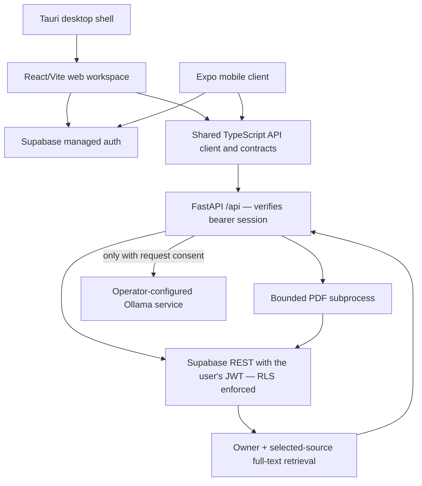

> **Release follow-up:** see [current setup and release execution log](SYNAPSEHUB_RELEASE.md) for deployment, patched dependencies and remaining operator steps.
> **Single release assessment:** the evidence-backed classification of every capability, and the ordered closure plan, live in [SYNAPSEHUB_PRODUCTION_READINESS.md](SYNAPSEHUB_PRODUCTION_READINESS.md).

# SynapseHub connected beta — implementation and handoff

This supersedes the local-only scope in [the first milestone](SYNAPSEHUB_MVP.md).
The existing portfolio and `/system` remain intact. Web entry: `/synapsehub`.

## Delivered capabilities and verification boundaries

| Capability     | Implementation                                                                                                                                                       | Evidence / limits                                                                                                                                                            |
| -------------- | -------------------------------------------------------------------------------------------------------------------------------------------------------------------- | ---------------------------------------------------------------------------------------------------------------------------------------------------------------------------- |
| Authentication | Supabase email/password signup, confirmation flow, login, logout, refresh, web password reset and recovery update                                                    | SDK mocked in UI/browser tests; server auth gating tested. Real email delivery and end-user login have **not** been verified here.                                           |
| Cloud sync     | Explicit push/pull of a typed workspace snapshot with atomic server revision checks; per-account browser caches and opt-in guest import                              | UI conflict tests and live PostgreSQL compare-and-swap tests passed. Not automatic merge, realtime collaboration or offline sync.                                            |
| PDF ingestion  | Private original files, page-aware text extraction, bounded parser subprocess, idempotent per-owner SHA-256 import, stored passages, deletion with cascading indexes | Real generated PDFs parsed in API tests, original bytes round-tripped. No OCR, annotations, arbitrary file support or persistent job queue.                                  |
| Retrieval      | PostgreSQL English full-text retrieval, ranked passages, explicit selected-source filtering, owner RLS                                                               | Real database RLS/source-filter tests passed. Keyword retrieval, **not embeddings/semantic search**.                                                                         |
| AI             | Configurable Ollama `/api/chat` adapter, evidence-only JSON prompt, typed claims, citation-ID and exact-quote validation; explicit request consent                   | Adapter/invalid-output tests passed with mocked inference. No real model downloaded, benchmarked or invoked. Quote validation does not prove a claim follows from its quote. |
| Web reader     | Authenticated original-file download, browser PDF iframe/new-tab view and cited page navigation                                                                      | Browser support varies. Native built-in PDF viewer availability is not guaranteed.                                                                                           |
| Native mobile  | Real Expo/React Native UI: sign-in/signup, cloud task list/create/complete, PDF picker/upload, source selection, evidence and AI results                             | Type checking, Expo dependency check, Android **and iOS Hermes bundle export** passed. No device/emulator testing, APK/IPA, signing or app-store release.                    |
| Desktop        | Tauri v2 Rust entry, desktop window configuration, restricted capabilities and CSP, existing web workspace packaged as frontend                                      | CLI configuration/prerequisite inspection only. No Rust/Cargo/WebKit toolchain here; **no compiled installer or native runtime verification**.                               |

The cloud schema has actually been applied to the connected **synapsehub** Supabase
project. Other Supabase projects were not changed. Authentication settings were
inspected, not weakened: email confirmation remains required. Existing data was
not migrated or uploaded. The database contains no retained test-user fixtures.

## Architecture



The backend never uses a service-role key. Every database request carries the
calling user's JWT, so authorization is enforced by PostgreSQL as well as the API.
The API verifies the session with Supabase Auth before accessing private data.

### Repository layout

- `backend/synapsehub/`: FastAPI endpoints, Pydantic contracts, Supabase gateway,
  bounded extraction and Ollama generation adapter.
- `backend/tests/`: deterministic tests, including real PDF fixtures generated in memory.
- `infrastructure/supabase/001_connected_workspace.sql`: additive schema and RPCs.
- `infrastructure/supabase/security_checks.sql`: transactional, rolled-back RLS/CAS checks.
- `packages/synapse-client/`: shared typed HTTP client and workspace contracts.
- `src/features/synapsehub/`: web auth/session boundary, cloud panel, existing local workspace.
- `native/mobile/`: independent Expo client with locked dependencies.
- `native/desktop/`: Tauri CLI/configuration/Rust entry.
- `tools/synapsehub-smoke/`: Chromium/Playwright browser smoke harness.
- `.github/workflows/synapsehub.yml`: web checks, backend tests, native JS bundle checks.

## Local setup

Node 22 and Python 3.11 were used. No paid model provider or credentials are
required for the automated tests.

```sh
npm ci
python -m venv .venv
.venv/bin/pip install -r backend/requirements.lock
cp .env.example .env.local
cp backend/.env.example backend/.env.local
```

Configure both files with your Supabase project URL and **publishable** key:

```text
# .env.local — browser-exposed configuration, never a secret/service-role key
VITE_SUPABASE_URL=https://your-project.supabase.co
VITE_SUPABASE_PUBLISHABLE_KEY=your-publishable-key
VITE_API_ORIGIN=

# backend/.env.local
SUPABASE_URL=https://your-project.supabase.co
SUPABASE_PUBLISHABLE_KEY=your-publishable-key
OLLAMA_URL=
OLLAMA_MODEL=
```

The current sandbox's ignored `.env.local` files were configured with the existing
project's **public publishable** key. These ignored files are not a portable setup
mechanism; recreate them on another machine. No secret API key was stored.

For a fresh project, apply `001_connected_workspace.sql` once using the project's
migration workflow. It is already applied to the connected project; **do not rerun
it there**, since this initial migration is intentionally not an upsert migration.

Start API and web in separate terminals:

```sh
set -a; . backend/.env.local; set +a
PYTHONPATH=backend .venv/bin/uvicorn synapsehub.main:app --host 0.0.0.0 --port 8000
# Other terminal:
npm run dev -- --host 0.0.0.0
```

Vite proxies browser `/api` requests to the API; browser code never calls the
user's localhost to reach another server. `/api/health` reports configuration flags,
not proof of external service connectivity. API documentation is at `/docs` on
the API server. Private routes require a bearer access token.

### Auth redirect setup (required per deployment)

In Supabase Auth URL configuration, set the actual web deployment's Site URL and
allow its exact `/synapsehub` confirmation/recovery redirect URL. For a local dev
machine use its local origin; for a preview use the preview's HTTPS origin. The
existing project's Site URL was still `http://localhost:3000` when inspected; it
was **not changed to a guessed production domain**. Configure it before testing
email links. Password recovery is handled by the web client and the Supabase SDK's
PKCE/session callback; mobile users can finish recovery on that configured web URL.
Do not disable email verification merely to make a demo easier.

### Network restriction in this sandbox

The coding sandbox only permits outbound traffic to selected package/GitHub hosts,
not Supabase or Ollama hosts. Database migrations/SQL tests were run through the
connected Supabase tool; API tests used deterministic user-scoped adapters. A
browser on the user's machine may reach Auth directly, but **this preview's API
cannot complete Supabase REST calls under that network restriction**. Run/deploy
the API in an environment that can reach Supabase before expecting end-to-end
cloud uploads/sync. No API deployment has been performed in this iteration.

## Workflow and sync semantics

1. Work as guest locally, or sign in. These are separate caches.
2. Signing in remounts the workspace using `synapsehub.workspace.v1.<user-id>`;
   guest items are not silently mixed into the account or uploaded.
3. Optionally import the guest copy into the account's local cache after confirmation.
4. **Check cloud version**, then explicitly **Push local copy**. Upload requires
   confirmation and the exact expected cloud revision.
5. A stale write returns `409`. The server never retries it as an unconditional
   overwrite. Export local changes and reconcile them before pulling/pushing again.
6. **Pull cloud copy** replaces the account-local cache only after confirmation and
   payload validation. A local persistence failure is surfaced, not called success.
7. Other devices use the same account and cloud API. Mobile edits operate against
   the revision loaded from the cloud and persist only after a successful response.

This is snapshot synchronization, not automatic field-level merging. Browser
writes still have localStorage's simultaneous-tab race limitation. Use one local
tab. Account caches and guest content remain in plaintext browser storage after
sign-out; a later guest does not see them through the UI, but this is **not**
protection from a shared device/profile owner or XSS. Browser auth tokens are
managed by Supabase's browser SDK. Export/clear site data as appropriate. No
account-deletion UI or complete erasure-from-backups claim is made.

## PDF and retrieval behavior

- Upload cap 5 MiB; 1–100 pages; at most 200,000 extracted characters.
- PDFs must have the PDF signature and parse successfully. Encrypted/malformed or
  wholly scanned documents fail explicitly. Some textless pages produce `partial`.
- Extraction runs in a spawned process with a 20-second parent timeout and, on
  Linux, CPU/address-space limits. Two parser processes per API worker are allowed.
- Requests are size-capped, throttled per access token, and ingestion runs off the
  event loop. This is bounded request-based processing, **not a durable job queue**.
  A disconnected client can refresh the library and retry the same file safely.
- Original bytes are stored as PostgreSQL `bytea` for this bounded implementation.
  This is a deliberate small-library tradeoff, not an object-storage architecture
  for large files. Use private object storage and a durable queue before scaling.
- Page-local chunks use 1,200-character windows with 200-character overlap; page
  boundaries are never crossed. Metadata retains page, document and chunk IDs.
- Same-owner duplicate PDFs reuse the existing document. Other owners cannot see
  the duplicate hash/library. Deleting a document cascades its chunks.
- Library listing currently caps at 200 newest PDFs. Pagination/OCR/replacing files
  and background job recovery are future work.
- Retrieval uses `websearch_to_tsquery('english', question)` and ranked full-text
  matches. Use concrete keywords; paraphrase/multilingual recall is limited. No
  embeddings, reranker or vector index is claimed.
- Selecting sources is enforced inside the SQL query, not just in the UI. The API
  also rejects adapter results referencing an excluded document.

## AI configuration and safeguards

Set `OLLAMA_URL` and `OLLAMA_MODEL` on the **API host**, after installing a model
you have evaluated and are licensed to use. For example, a locally operated Ollama
service can expose its `/api/chat` endpoint to that API host. No model name is
hardcoded and no model weights are bundled. Restart the API after changing config.

"Local inference" here means local to the configured API service, not necessarily
local to the user's browser or phone. A remotely hosted API/model is remote
inference. The UI discloses this and requires a consent checkbox for generation.
Retrieval works independently when generation is unavailable. There is **no silent
cloud fallback**. Provider endpoints cannot be supplied by uploaded source text
or browser requests.

The prompt labels evidence as untrusted, has no execution tools, and asks for JSON
claims with exact supporting quotes. The response is validated against a Pydantic
schema, allowed retrieved chunk IDs, and exact quote substrings. Invented citations
or quotes cause the entire generated answer to be rejected. Empty evidence returns
an explicit no-evidence message without invoking the model.

**Limits:** these controls do not prove entailment, factual correctness, or prompt-
injection immunity. A plausible false claim can cite an unrelated but real quote.
The UI labels generated claims as AI interpretations and exposes the original
passage/page for review. Model evaluation, semantic retrieval, supported/unsupported
claim scoring, and adversarial evaluation remain release gates. No AI tool can
modify the workspace, execute code, share documents or send notifications.

## Native clients

### Expo (iOS/Android)

```sh
cd native/mobile
npm ci
cp .env.example .env.local
# Set EXPO_PUBLIC_SUPABASE_URL, EXPO_PUBLIC_SUPABASE_PUBLISHABLE_KEY,
# and a reachable HTTPS EXPO_PUBLIC_API_ORIGIN (not localhost).
npm run typecheck
npx expo start
# With the appropriate platform tools installed:
npm run android
npm run ios
```

Session tokens use Expo SecureStore, split into small values for platform limits;
refresh follows app foreground/background state. Task/note lists use virtualized
FlatList and memoized rows; layout uses SafeAreaView, native controls and Pressable.
The client is online-only: private workspace data is not persisted offline. It is
not a webview wrapper. It does not yet have full web feature parity (rich editing,
original-PDF reader, recovery deep links, offline conflict resolution, notifications).
No mobile binary signing credentials or store accounts were used.

### Tauri (Windows/macOS/Linux build host)

```sh
cd native/desktop
npm ci
npm run dev
npm run build
```

Requires Rust/Cargo and the target platform's documented WebView/native build
prerequisites. Rust dependencies cannot be resolved/locked here without the Rust
registry/toolchain. Generate/review `Cargo.lock` on the build host before release.
The packaged app starts at `/synapsehub`; set `VITE_API_ORIGIN` to the deployed
HTTPS API for release builds (a bundle has no Vite proxy). Configure exact API CORS
origins for the desktop WebView (`tauri://localhost` / `http://tauri.localhost`,
according to platform), and appropriate Supabase auth redirect behavior before
shipping account recovery. Desktop email recovery can use the configured web URL;
there is no native deep-link recovery integration yet.

Tauri exposes no custom filesystem/shell commands and grants no IPC capabilities.
The CSP is a starting policy, not a security audit; tighten `connect-src https:` to
actual API/Auth hosts for a release. This iteration does not deliver installers.

## Deployment and production gates

`backend/Dockerfile` provides a non-root API container using the locked Python
requirements. It has not been built here. Deploy web assets plus an HTTPS reverse
proxy mapping `/api` to the API (or use `VITE_API_ORIGIN` and exact `CORS_ORIGINS`).
Store only publishable/anon keys in clients. Do not configure a service-role key.

Before production: shared rate limits/user quotas, ingress upload/time limits,
malicious-PDF isolation review, durable ingestion jobs, object storage, database
backup/recovery tests, email delivery/redirect verification, auth abuse controls,
AI faithfulness evaluations, accessibility audit, signed native builds/device tests,
deletion/retention policy, dependency remediation and deployment smoke tests.

`npm audit` for the web project reported zero vulnerabilities after installing the
Auth SDK. The mobile dependency audit still reports **8 advisories (5 low, 3 high)**
in Expo tooling/transitive dependencies at the last check. A nonbreaking audit fix
was applied; the remaining advisories were not force-downgraded or hidden. Review
and remediate them before distributing a native release.

## Checks executed in this iteration

- Root TypeScript, targeted ESLint and production build: passed.
- Root suite: 598 tests after adding five auth/cloud UI tests.
- Backend: 10 tests passed (one upstream Starlette/httpx deprecation warning).
- Live Supabase: RLS enabled on all three tables; own-source access, cross-user
  exclusion, selected-source retrieval and stale revision rejection asserted inside
  a transaction; fixture users/documents rolled back and absence confirmed.
- Playwright/Chromium: real guest source→task flow, persistence after reload, real
  SDK sign-in against **mock auth transport**, account isolation, cloud conflict
  response and 390px non-overflow layout; no JavaScript page errors. This does not
  verify Supabase email delivery, live HTTP cloud storage, AI or WCAG compliance.
- Expo: TypeScript, offline local dependency-compatibility check, Android and iOS
  Hermes bundle exports passed. No native platform runtime tests.
- Tauri: CLI configuration/prerequisite inspection only; missing Cargo/Rust/WebKit.
- Existing repository-wide lint errors in unrelated `apps/*` remain; scoped checks
  pass without suppressing those violations. CI definition added, not run on GitHub.

Reproduce checks:

```sh
npm run typecheck
npx eslint src/features/synapsehub packages/synapse-client src/App.tsx vite.config.ts eslint.config.js native/mobile tools/synapsehub-smoke
npm test
npm run build
PYTHONPATH=backend .venv/bin/pytest -q backend/tests
npm run typecheck --prefix native/mobile
(cd native/mobile && EXPO_OFFLINE=1 npx expo install --check)
(cd native/mobile && npx expo export --platform android --output-dir dist/android)
(cd native/mobile && npx expo export --platform ios --output-dir dist/ios)
# With the configured web development server running:
npm ci --prefix tools/synapsehub-smoke
npm test --prefix tools/synapsehub-smoke
```

The smoke harness uses the npm-distributed Linux Chromium binary; on another OS
supply `SMOKE_CHROMIUM_PATH`. Generated screenshots/bundles/binaries are ignored.

## Repository-hosted skills consulted

Reviewed the guidance as reference material; did not execute unreviewed repository
scripts or copy entire skill repositories into the app:

- [anthropics/skills PDF](https://github.com/anthropics/skills/blob/4e6907a33c3c0c9ce7c1836980546aaba78a34b5/skills/pdf/SKILL.md): pypdf page extraction, encrypted/scanned-file handling, ReportLab test fixtures.
- [anthropics/skills webapp-testing](https://github.com/anthropics/skills/blob/ef740771ac901e03fbca3ce4e1c453a96010f30a/skills/webapp-testing/SKILL.md): inspect rendered state, wait for initialization, browser interaction and screenshots rather than relying solely on component tests.
- [vercel-labs/agent-skills React Native](https://github.com/vercel-labs/agent-skills/blob/757ccb42a20478be6b7284088978070358b52d5e/skills/react-native-skills/SKILL.md): virtualized lists, stable/memoized rows, safe areas, Pressable, native-specific dependencies and explicit state ownership.
