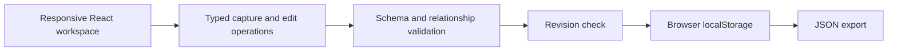

> **Historical first milestone.** The connected beta now adds auth, PDF ingestion,
> retrieval/AI, cloud sync and native client projects. See
> [current implementation and limitations](SYNAPSEHUB_CONNECTED.md).
> The local-only claims below describe the original milestone, not the current scope.

# SynapseHub: connected workspace milestone

## Scope and repository decision

The supplied blueprint is the long-term product direction, not a claim that every
capability is delivered. Inspection found a React 19 / TypeScript / Vite portfolio,
with an existing `/system` personal-OS experience and many independent apps.
Replacing it with a Next.js monorepo would destroy working functionality without
helping validate the central workflow. This milestone therefore adds an isolated,
lazy-loaded `/synapsehub` route and a link in the existing navigation. No existing
routes or storage keys are repurposed. No dependencies were added.

**Delivered vertical slice:** manually capture a source excerpt → derive a note or
task → preserve its origin → edit task details → complete/reopen task → reload and
retrieve the saved state. Sources, notes and tasks can all be linked to existing
items at creation time. Context is navigable in both directions.

### Implemented

- Responsive dedicated workspace shell, neutral surfaces and green accent tokens.
- Empty workspace (no fabricated personal records or analytics).
- Overview counts calculated from stored records.
- Task, note, and manually pasted source-excerpt capture.
- Tasks with completion, high/normal priority, and optional local-calendar due date.
- Item editing, plain-text content, safe http(s) source links.
- Explicit `derived-from` relations and backlinks, stable UUID references on rename.
- Separate task/note/source lists, title/content substring search, relationship ledger.
- Quick capture with Ctrl/Cmd+K, Escape dismissal, labelled inputs and visible focus.
- Versioned browser persistence, validation, quota/access error reporting, corrupt
  data protection, and revision checks to reject sequential stale-tab writes.
- JSON download preserving identifiers, content and relationships, including raw
  stored data when decoding fails (recovery export).

### Not implemented

Authentication, server APIs, PostgreSQL, projects, labels, folders, PDF upload or
reading, rich-text/Markdown rendering, verified page citations, document ingestion,
embeddings, semantic retrieval, AI inference, scheduling, reminders, flashcards,
media generation, graph visualization, import UI, cloud sync, collaboration,
installable PWA, native mobile and desktop clients. There are no fake AI responses,
placeholder AI buttons, simulated citations or external integration claims.

## Run and exercise

```sh
npm ci
npm run dev -- --host 0.0.0.0
# Open /synapsehub (or use SynapseHub in the portfolio navigation)
npm run typecheck
npx eslint src/features/synapsehub src/App.tsx src/components/navigation/SiteHeader.tsx
npm test
npm run build
```

1. Use Quick capture, choose Source excerpt, give it a title, and paste a passage.
2. Optionally supply an original URL; it is stored, **not fetched**.
3. Save, select the source, and choose Create linked note or Create linked task.
4. Review copied content and choose a title. For tasks, optionally set due date and priority.
5. Save and select the derived item. Linked context navigates back to the source;
   the source's backlinks show the derived item.
6. Edit the task, mark it complete, refresh, and confirm the state remains.
7. Export workspace regularly. Downloads contain plaintext personal content.

The export is a portability/recovery artifact, not an implemented backup/restore
product. Technical recovery currently requires restoring valid JSON under the same
browser storage key using developer tools. Keep the raw original before doing so.

## Architecture



- `src/features/synapsehub/workspace.ts`: discriminated `Task | Note | Source`
  contracts, capture/edit rules, safe URL policy, schema loading, storage boundary.
- `SynapseHubPage.tsx`: presentation and interaction; writes succeed before state
  is changed in the UI. The standalone route does not inherit portfolio chrome.
- `synapsehub.css`: scoped design tokens and responsive desktop/mobile layout;
  dark styling follows the OS preference independently of the portfolio theme.
- `Workspace.version` describes the schema; `revision` counts successful writes.
  There is no migration from other products' data. Unsupported formats fail closed.
- Task due dates are `YYYY-MM-DD` user-entered dates, not scheduled instants. Creation
  timestamps are UTC ISO strings. There is no ambiguous natural-language parser.
- Relations use stable IDs, disallow missing endpoints/self-links/duplicates, and
  are user-confirmed on capture. No item deletion exists in this milestone, so
  there is no implied cascading-delete policy.

## Security, privacy and limits

This is a single-browser prototype, not a secured multi-user personal-data service.
Browser storage is plaintext, scoped to the origin, and accessible to other scripts
on that origin. It is not encrypted or protected by accounts. Do not use shared
browser profiles for sensitive research. Clearing site storage removes all data;
exports remain until the user deletes them. No cloud copies or backups are made.

Content is rendered as React text, never arbitrary HTML. Only http(s) source URLs
are accepted. Links are opened only on explicit user action. Capture, search and
export do not make application data requests or AI calls. Opening a source URL
navigates to that third-party website and is subject to its privacy practices.

Storage exceptions are surfaced and unsaved changes are not reported as saved.
Malformed/unsupported stored data blocks writes and can be exported for recovery.
Revision checks detect ordinary stale tabs, but localStorage has no transactional
compare-and-swap: simultaneous writes can still race. Concurrent multi-tab editing
is **not supported**; use one tab. The prototype has no pagination or large-library
performance guarantee. Title length is limited to 200 and entered content to 50,000
characters; browser storage quota is a practical overall limit.

No AI evidence claim is made about manually pasted excerpts. AI integration must
separate original evidence, model inference and recommendations, preserve document
locations, enforce source selection at retrieval time, and never silently fall back
to a hosted provider. Model names/licenses from the blueprint remain evaluation
candidates, not integrated or verified dependencies.

## Next milestones and acceptance gates

1. **Account/workspace backend:** authenticated FastAPI modular monolith,
   PostgreSQL/Alembic, workspace ownership and authorization tests for direct reads,
   updates, search and exports. Define API contracts before migrating local records;
   do not automatically upload existing local data. Add supported JSON import with
   validation, preview and duplicate/conflict policies.
2. **Knowledge + document slice:** notes/projects, attachment storage boundary,
   real PDF extraction/reader, highlights with page anchors, processing statuses,
   size limits, permission checks and deletion/index lifecycle tests.
3. **Local RAG slice:** provider interface, explicit local service configuration,
   permission/source-filtered retrieval, embedding provenance and verifiable passage
   citations. Evaluate answer-absent cases and prompt-injection fixtures. A browser
   preview must not assume Ollama exists on the user's machine.
4. **Planning/learning:** scheduling and flashcards derived from the same evidence
   model; deterministic recurrence/review rules and tests before AI automation.
5. **Deployment/platform hardening:** readiness/security/accessibility review,
   browser E2E and responsive visual testing, then PWA/native/desktop work as separately
   tested deliverables. No framework migration or hosted deployment is presumed.

## Executed checks (2026-10-27)

- `npm run typecheck`: passed.
- `npm test`: **593 tests passed across 15 files**, including 9 new tests for
  domain integrity, persistence, unsafe inputs, stale/corrupt data, quota errors,
  keyboard capture and a source→task edit/complete/remount UI workflow.
- `npm run build`: passed.
- Targeted ESLint command above: passed.
- `npm run lint`: failed in unrelated existing `apps/*` files, with 32 errors and
  3 warnings. These were not suppressed or modified by this milestone.

Tests use Vitest/jsdom; they do not prove browser layout, WCAG compliance, native
platform behavior or real cross-device synchronization. No production deployment,
AI evaluation or production-readiness assessment has been performed.
