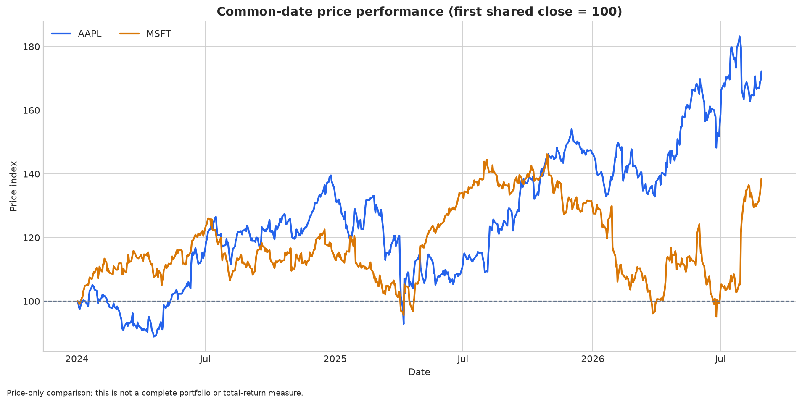

# Stock Price Analysis — Comparative Time-Series Analytics (v2)

A tested, reproducible Python workflow for retrieving, validating, transforming, comparing, visualizing, and reporting historical financial time series. This is the expanded second version of the simpler [`../stock-price-analysis`](../stock-price-analysis/README.md) notebook, which remains intact.

> **Educational historical analysis only—not financial advice.** Historical returns do not guarantee future returns. Moving averages, volatility, drawdown, and correlation are descriptive and do not predict prices or identify investments.



## Project overview

The project asks how configurable securities changed over a selected historical period and demonstrates how daily OHLCV observations can be validated, indexed by date, resampled, rolled, aligned, and interpreted responsibly. The default executed sample compares Apple (`AAPL`) and Microsoft (`MSFT`) from 2024-01-02 through 2026-08-28, but the live retrieval and analysis modules support other valid ticker lists and date ranges without rewriting the workflow.

The notebook is the explanatory entry point; reusable modules contain the production logic. No static dashboard or hidden notebook-only implementation is required.

## Key features

- Explicit `yfinance` retrieval settings for ticker list, dates, interval, adjustment, caching, and refresh behavior.
- Per-ticker failure reporting, strict/partial behavior, ordinary and MultiIndex response normalization, and no silent data substitution.
- Data provenance with requested/actual periods, source, retrieval timestamp, row count, adjustment setting, and library versions.
- Validation for empty responses, schema, numeric types, `DatetimeIndex`, chronological order, duplicates, missing values, price/volume bounds, OHLC consistency, unusual gaps, and minimum history.
- Date slices, inner common-date alignment, Friday-ending weekly and month-end OHLCV resampling.
- Full-window 20-session and 200-session simple moving averages without look-ahead or artificial warm-up values.
- Individual, nominal-comparison, normalized-performance, frequency, moving-average, volume, volatility, drawdown, and correlation charts.
- Daily returns, CAGR, annualized historical volatility, maximum drawdown, approximate turnover, and descriptive statistics.
- Computed findings that separate observed facts, statistical results, limitations, and explanations the data cannot establish.
- Non-destructive exports for processed daily data, weekly/monthly data, moving averages, summary tables, charts, and a Markdown report.
- 39 deterministic pytest tests, including mocked provider responses; tests do not require Yahoo Finance connectivity.

## Technology stack

| Technology | Role |
| --- | --- |
| Python | Reusable implementation and orchestration |
| Pandas | Date indexes, alignment, resampling, rolling windows, returns, exports |
| NumPy | Numerical metrics and missing-value semantics |
| yfinance | Configurable Yahoo Finance client |
| Matplotlib | Reproducible, publication-quality static charts |
| Jupyter | Literate analysis, outputs, and interpretation |
| pytest | Controlled validation, aggregation, metric, reporting, and mocked-download tests |
| Ruff | Formatting and static lint checks |

## Installation

Python 3.10 or later is required.

```bash
cd stock-price-time-series-analysis
python -m venv .venv
source .venv/bin/activate             # Windows: .venv\Scripts\activate
python -m pip install --upgrade pip
python -m pip install -e ".[dev,notebook]"
```

For notebook/runtime dependencies only:

```bash
python -m pip install -r requirements.txt
```

## Running the analysis

### 1. Inspect the reproducible archived-sample run

```bash
STOCK_ANALYSIS_DATA_MODE=sample jupyter lab notebooks/stock_price_analysis.ipynb
```

Choose **Run → Run All Cells**. Sample mode is explicit and supports the documented `AAPL`/`MSFT` files in `data/sample/`; it is not an automatic fallback.

### 2. Request fresh data with yfinance

```bash
STOCK_ANALYSIS_DATA_MODE=live jupyter lab notebooks/stock_price_analysis.ipynb
```

Edit the single `AnalysisConfig(...)` cell to select companies and dates:

```python
config = AnalysisConfig(
    tickers=("NVDA", "GOOGL", "MSFT"),
    start_date="2021-01-01",
    end_date="2026-09-01",  # provider end date is exclusive
    interval="1d",
    auto_adjust=False,
    price_field="Close",
    cache_enabled=True,
    refresh_cache=False,
)
```

Set `refresh_cache=True` to bypass matching cached requests. To clear every local cache manually:

```bash
rm -f data/cache/*.csv data/cache/*.metadata.json
```

Cache filenames encode ticker, requested dates, interval, and adjustment mode. A cache is convenient, not guaranteed current. Invalid symbols, empty responses, rate limits, network failures, and partial results are reported; live mode never switches silently to archived or synthetic data.

For one-, three-, or five-year configurations, `AnalysisConfig.trailing_years(5, end_date="2026-09-01", tickers=(...))` is available. A 200-session average still requires adequate downloaded warm-up history. Use `display_start` or filter after calculating indicators when the display window is shorter than the download window.

### 3. Generate artifacts

Running all cells creates files under:

- `data/processed/` — normalized daily outputs (ignored locally by Git);
- `outputs/tables/` — weekly/monthly bars, moving averages, summary, normalized performance, correlation;
- `outputs/figures/` — high-resolution PNG charts;
- `outputs/reports/` — computed Markdown report.

Filenames contain tickers and requested dates. Raw inputs are never overwritten.

### 4. Run quality checks

```bash
pytest -q
ruff format --check .
ruff check .
```

The download tests inject mocked yfinance-style responses for success, empty data, network failure, both common MultiIndex orientations, explicit partial failure, cache reuse, and forced refresh. Resampling tests use controlled OHLCV values rather than live data.

## Sample results

The committed notebook and report use the explicitly documented archived sample—not a successful live download in this environment. Over the common 2024-01-02 to 2026-08-28 window, the computed run found:

- AAPL price-only change: **72.2%**; MSFT: **38.5%**.
- AAPL annualized daily-return volatility: **27.7%**; MSFT: **26.9%**, using √252.
- AAPL mean daily volume: **54.3 million shares**; MSFT: **25.2 million shares**.
- Both final closes were above their trailing 200-session averages.
- AAPL/MSFT daily returns had a **0.34** Pearson correlation on common dates.

These values are historical sample calculations, not predictions or recommendations. See the generated [analysis report](outputs/reports/aapl-msft_20240101_20260901_analysis_report.md) for provenance, complete metrics, and limitations.

Major figures communicate different questions:

- **Normalized performance:** relative price change from a shared baseline, not nominal share-price difference.
- **Frequency comparison:** how weekly/monthly point reduction smooths presentation while close remains period-last.
- **Moving averages:** short/long trailing descriptions with explicit warm-up gaps.
- **Volume:** raw shares, rolling activity, own-mean normalization, and weekly totals.
- **Volatility/drawdown/correlation:** historical variability, running-peak declines, and association on common dates.

## Project structure

```text
stock-price-time-series-analysis/
├── notebooks/stock_price_analysis.ipynb
├── src/stock_analysis/
│   ├── config.py             # central validated settings
│   ├── data_loader.py        # yfinance, provenance, caching, explicit local loading
│   ├── data_validation.py    # data-quality report and strict checks
│   ├── preprocessing.py      # canonical structure, date selection, alignment
│   ├── time_series.py        # resampling, moving averages, returns, volatility
│   ├── metrics.py            # performance, drawdown, correlation, summary
│   ├── visualization.py      # consistent Matplotlib figures and PNG export
│   └── reporting.py          # computed findings, CSV and Markdown exports
├── tests/                    # controlled and mocked automated tests
├── data/
│   ├── sample/               # documented archived AAPL/MSFT sample
│   ├── cache/                # ignored yfinance cache
│   ├── raw/                  # ignored user inputs
│   └── processed/            # ignored regenerated outputs
├── outputs/{figures,reports,tables}/
├── portfolio/                # metadata, case study, genuine generated thumbnail
├── pyproject.toml
├── requirements.txt
└── LICENSE
```

## Methodology

### Data source and adjustment

Live mode calls Yahoo Finance through `yfinance` with explicit `interval`, `auto_adjust`, `actions`, threading, timeout, and date parameters. The executed sample has separate provenance in [`data/sample/README.md`](data/sample/README.md). With `auto_adjust=False` and `price_field="Close"`, results are labeled unadjusted price-only performance. `Adj Close` is retained separately where supplied.

### Date handling and quality

Normalization parses `Date`, removes timezone from daily labels, sorts chronologically, and sets a unique `DatetimeIndex`. Required values are never interpolated or forward-filled. Weekends and holidays are not treated as missing prices. Common-date analysis uses an inner join so each compared return has observations for every selected ticker.

### Resampling

Weekly rule: `W-FRI`; monthly rule: `ME` for Pandas 2.2+. Aggregation is open=first, high=max, low=min, close/adjusted close=last, volume=sum. Partial boundary periods are retained by default and documented.

### Rolling statistics and returns

Simple moving averages use `.rolling(window=n, min_periods=n)`, so the first `n-1` values remain missing. Daily returns use `.pct_change(fill_method=None)`. Volatility is sample standard deviation of daily returns annualized by √252. Drawdown compares each price with the running peak. Correlation is Pearson correlation of inner-aligned daily returns.

## Data and analytical limitations

- Fresh Yahoo Finance retrieval could not be verified in the restricted build environment; mocked integration behavior and archived-data processing were verified.
- Yahoo Finance can be unavailable, delayed, incomplete, rate-limited, corrected, or adjusted differently from other sources.
- Price-only performance can omit dividends and is not total shareholder return.
- Nominal price, absolute price change, and raw share volume are not direct company-value or investment-performance comparisons.
- Approximate `price × volume` turnover remains an incomplete liquidity measure.
- Historical metrics depend on the selected sample, alignment, and surviving securities.
- Correlation is not causation; historical volatility and moving averages do not forecast outcomes.
- Prices and volume cannot establish why a market movement occurred.

## Future improvements

Potential—not currently claimed—extensions include second-provider reconciliation, explicit dividend total-return analysis, benchmark/sector comparisons, rolling correlation, alternative volatility estimators, scheduled cache refreshes, and optional interactive views that complement rather than replace reproducible static output.

## Portfolio integration

[`portfolio/project-metadata.json`](portfolio/project-metadata.json) contains the requested slug, category, technologies, configurable null URLs, notebook path, and thumbnail path. [`portfolio/CASE_STUDY.md`](portfolio/CASE_STUDY.md) records objectives, engineering decisions, testing, actual sample findings, limitations, and lessons learned. Repository and live-demo URLs remain `null` until genuine destinations are configured.
